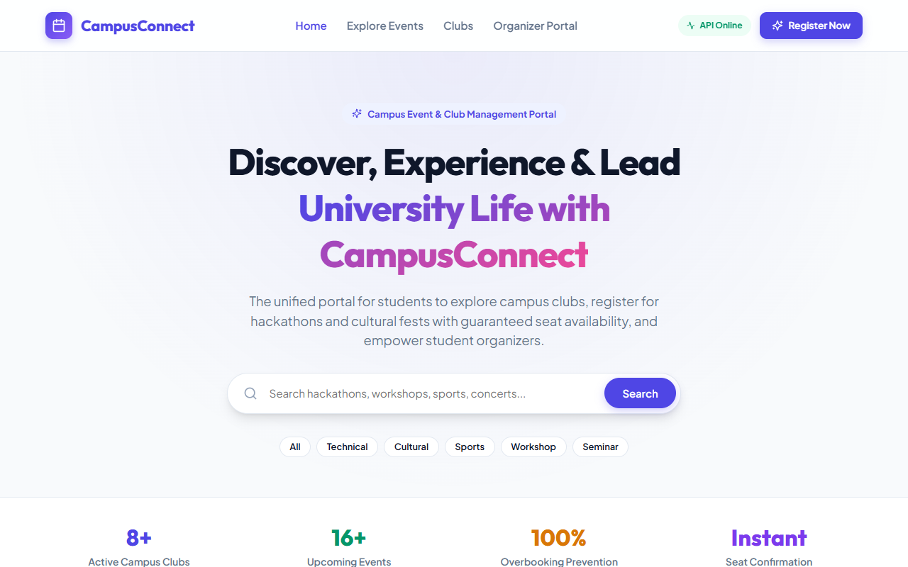
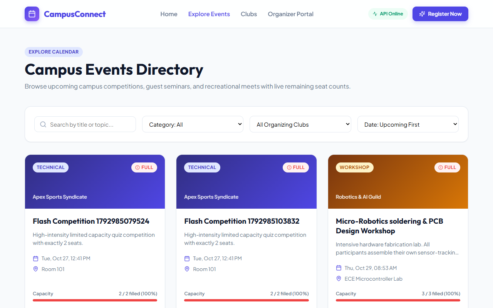
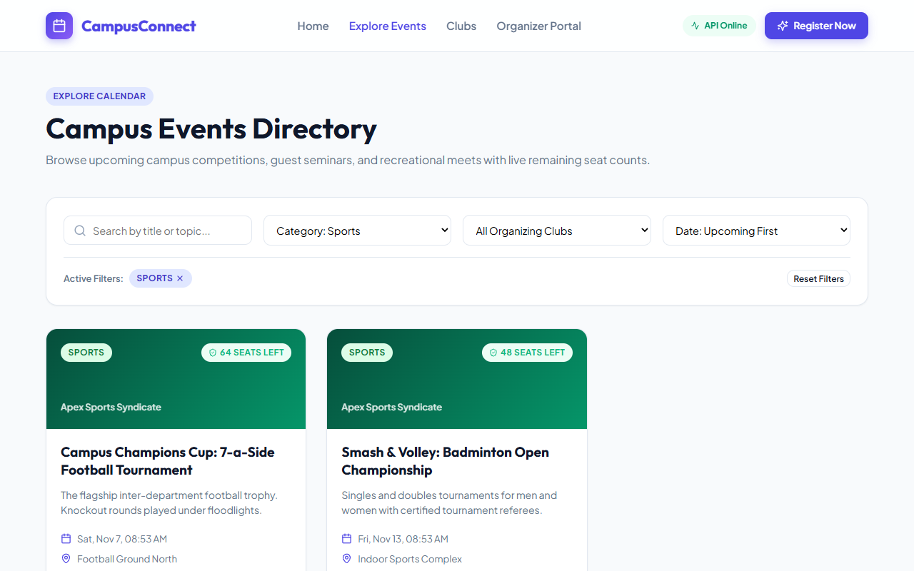
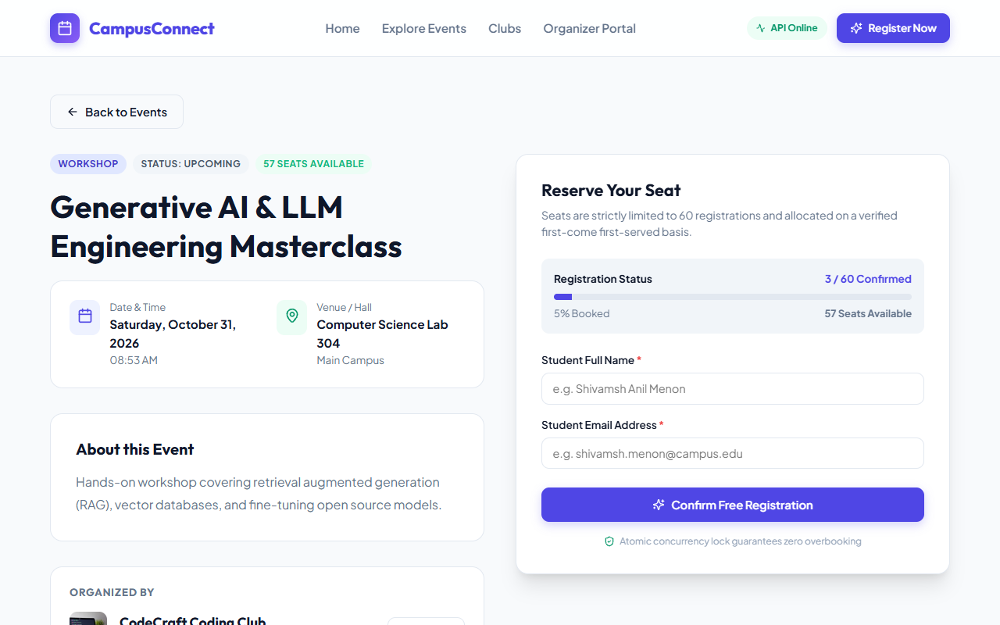
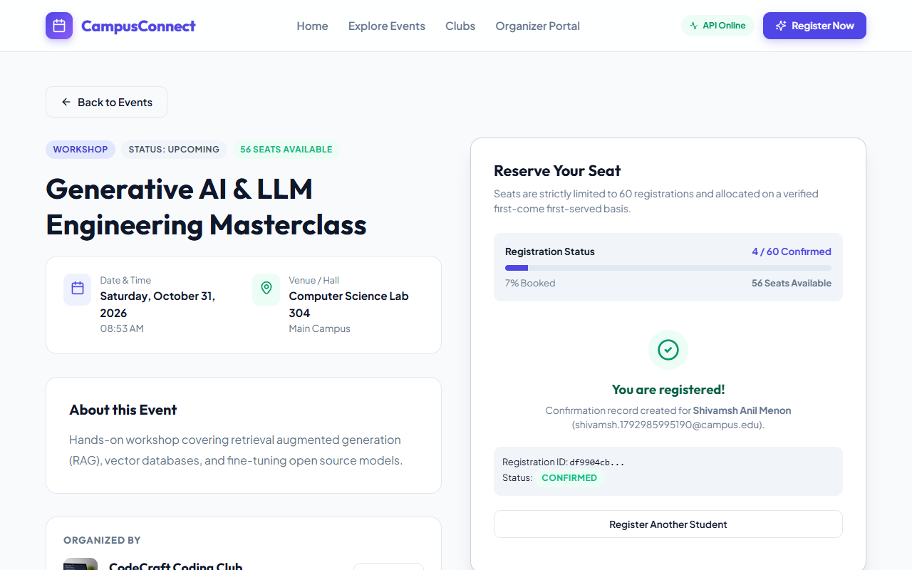
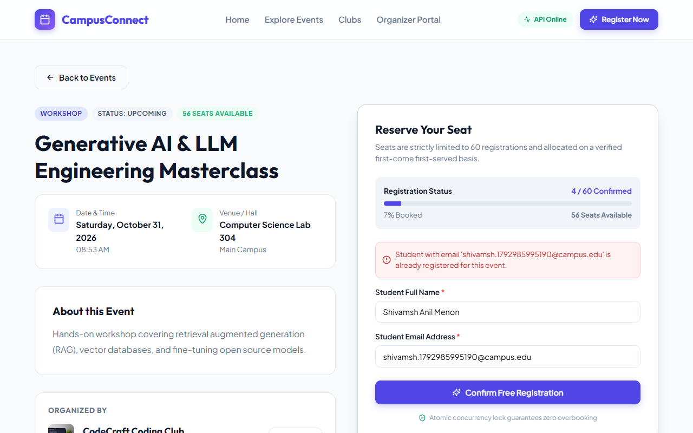
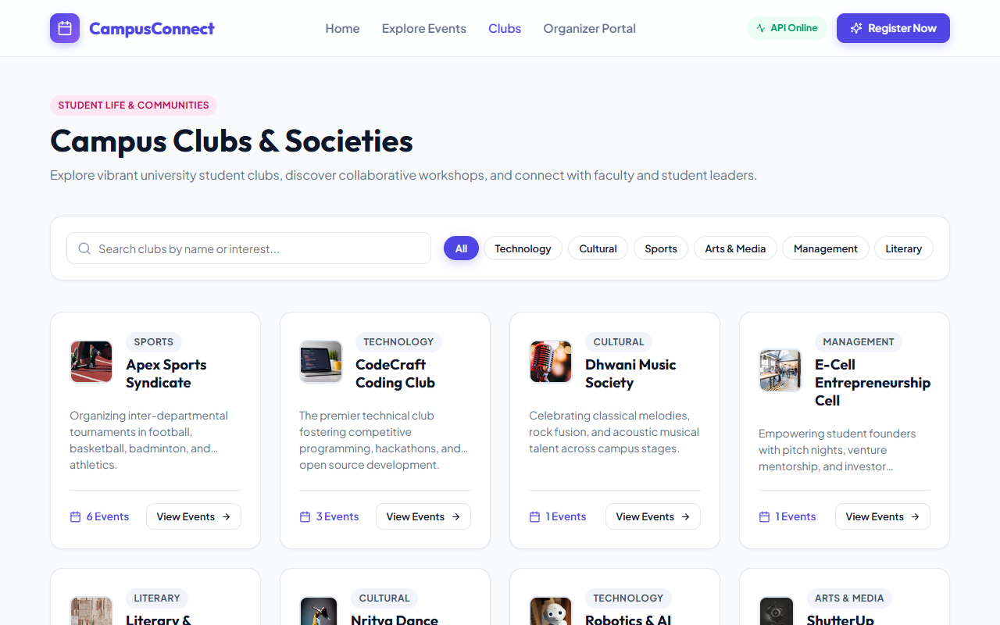
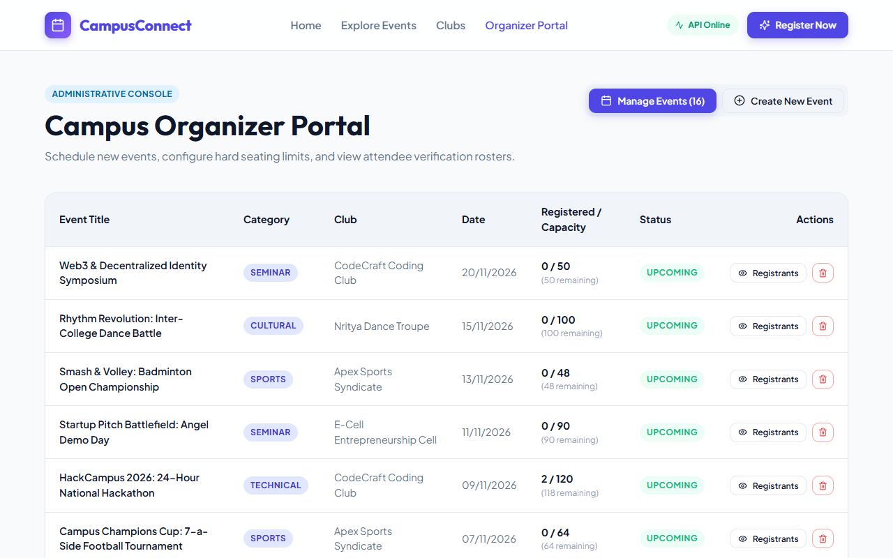
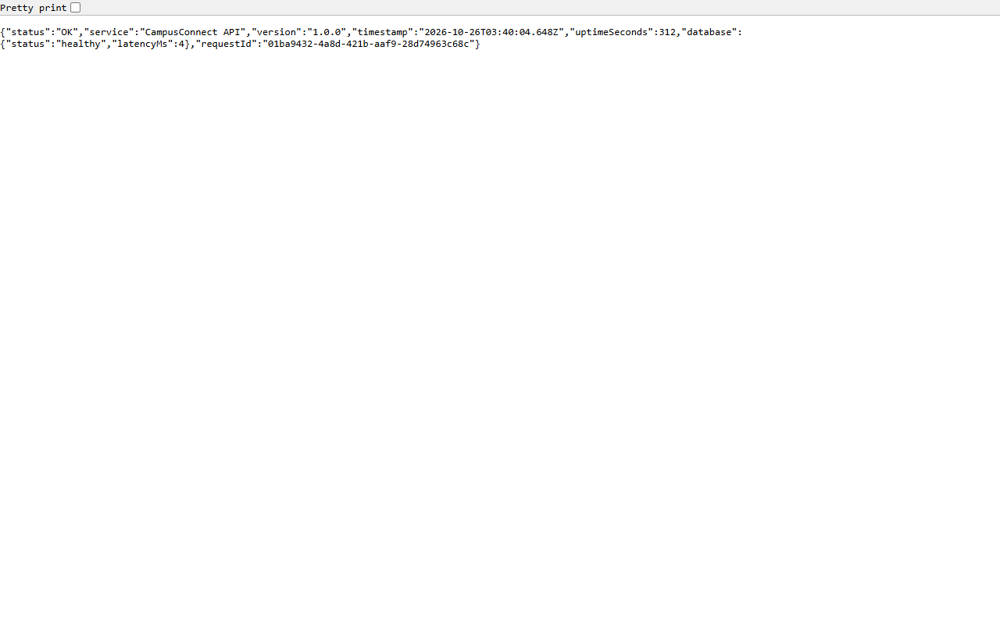

# CampusConnect: Campus Event & Club Management Portal

**Author**: Shivamsh Anil Menon  
**Academic Microproject**: Alliance University — Department of Computer Science & Engineering  
**Academic Year**: 2025–2026  
**Repository**: [https://github.com/CooCooCoder/Campus-Connect](https://github.com/CooCooCoder/Campus-Connect)  
**Live Demo**: [https://coocoocoder.github.io/Campus-Connect/](https://coocoocoder.github.io/Campus-Connect/)  
**Subjects Involved**:
1. Full Stack Development
2. Backend Development
3. Advanced Database Systems

---

## 1. Project Overview & Problem Statement
In contemporary universities, dozens of active student chapters and cultural clubs organize hackathons, conferences, and sports meets. However, event discovery and seat registrations are commonly managed across disconnected forms and chat channels, causing:
- **Venue Overbooking**: Lack of atomic seating checks allows more registrations than the venue capacity.
- **Duplicate Registrations**: Students re-submitting forms across multiple devices inflate attendee rosters.
- **Fragmented Discovery**: No centralized directory exists to view upcoming club schedules and real-time seat availability.

**CampusConnect** solves these problems by providing an integrated full-stack portal with real-time seat tracking, atomic compare-and-swap (CAS) database reservations, and dedicated student and organizer portals.

---

## 2. Key Features

- **Dynamic Homepage**: High-impact campus branding, live metric ticker, keyword search, category pills, and featured event cards.
- **Server-Driven Events Directory**: Search by title, filter by category (`Technical`, `Cultural`, `Sports`, `Workshop`, `Seminar`, `Literary`), filter by organizing club, sort by date/title, and paginate seamlessly.
- **Event Detail & Seating Gauge**: Dynamic availability progress bar displaying confirmed seats, remaining tickets, and fill percentage.
- **Atomic Concurrency Protection**: High-volume parallel registrations cannot exceed venue capacity; tested and verified with automated integration tests.
- **Club Directory**: Comprehensive profiles of student societies with event counts and organizer contact channels.
- **Organizer Administrative Portal**: Publish new campus events with client and server-side validation, manage existing activities, and view confirmed attendee rosters.
- **Polyglot Audit Logging**: High-throughput MongoDB document store recording operational activities with 90-day TTL index document purging.

---

## 3. Technology Stack

### Frontend
- **Framework**: React 18
- **Build Tool**: Vite 6
- **Routing**: React Router v6
- **Server State & Caching**: TanStack Query v5
- **HTTP Client**: Axios (configured with request/response interceptors)
- **Icons**: Lucide React
- **Styling**: Modern Vanilla CSS Design Tokens (Custom glassmorphism, responsive grid layouts)

### Backend
- **Runtime**: Node.js v24
- **Framework**: Express.js
- **Architecture**: Layered (`routes`, `controllers`, `services`, `repositories`, `validators`, `middleware`)
- **Tracing**: Custom Request ID middleware propagating `X-Request-Id`
- **Telemetry**: Structured request logger measuring millisecond response latency
- **Error Handling**: Centralized `errorHandler` normalizing operational errors

### Database Layer
- **Primary Relational Store**: PostgreSQL (Prisma ORM, 3NF/BCNF normalization, CHECK constraints, composite UNIQUE indexes, composite B-Tree indexes, JSONB GIN indexes)
- **Development Fallback**: SQLite (Zero-config local development with instant seed data)
- **Polyglot Document Store**: MongoDB 8 (Mongoose ODM, TTL indexes, multi-stage `$facet` analytical aggregation pipelines)

### Testing & QA
- **Automated Test Runner**: Node.js native test runner (`node --test`)
- **Browser Automation**: Puppeteer automated screenshot engine

---

## 4. Visual Evidence & Screenshots

| Interface | Screenshot Preview |
|---|---|
| **Homepage** |  |
| **Events Directory** |  |
| **Filtered Search** |  |
| **Event Details** |  |
| **Registration Confirmed** |  |
| **Duplicate Error** |  |
| **Club Showcase** |  |
| **Organizer Console** |  |
| **API Health Probe** |  |

---

## 5. Directory Structure

```
CampusConnect/
│
├── frontend/                     # React 18 + Vite SPA
│   ├── src/
│   │   ├── components/           # Navbar, Footer, EventCard, ClubCard, Modal, Pagination
│   │   ├── pages/                # LandingPage, EventsPage, EventDetailPage, ClubsPage, OrganizerDashboard
│   │   ├── services/             # Axios API client
│   │   ├── App.jsx               # React Router & TanStack Query client
│   │   └── index.css             # Responsive CSS design tokens
│   ├── index.html
│   └── package.json
│
├── backend/                      # Express REST API
│   ├── src/
│   │   ├── config/               # Prisma client singleton
│   │   ├── controllers/          # HTTP request handlers
│   │   ├── services/             # Domain logic & seat calculations
│   │   ├── repositories/         # Prisma queries & CAS transactions
│   │   ├── middleware/           # RequestId, logger, centralized error handler
│   │   ├── validators/           # Event and registration validators
│   │   └── utils/                # Standardized ApiResponse & AppError
│   ├── prisma/
│   │   ├── schema.prisma         # Relational schema
│   │   └── seed.js               # Idempotent database seeder
│   ├── tests/
│   │   └── api.test.js           # Automated integration test suite (15 tests)
│   └── package.json
│
├── database/                     # Advanced Database Systems materials
│   ├── sql/
│   │   ├── 01_schema_ddl.sql     # PostgreSQL DDL with check & unique constraints
│   │   └── 02_advanced_queries.sql # CTE analytics, window functions, EXPLAIN ANALYZE
│   ├── er-diagram/
│   │   └── er-diagram.md         # Mermaid ER diagram & 3NF/BCNF normalization proof
│   └── query-analysis/
│       └── concurrency-and-mvcc.md # MVCC, snapshot isolation & overbooking prevention
│
├── mongodb/                      # Document store extension
│   ├── models/                   # ActivityLog (TTL 90d), Notification (Embedding vs Referencing)
│   ├── scripts/
│   │   └── demo-aggregation.js   # $facet multi-dimensional aggregation pipeline
│   └── README.md                 # Polyglot architecture & dual-write mitigation
│
├── reports/                      # Academic Project Reports & Proposal (DOCX & PDF)
│   ├── Full-Stack-Development-Report.docx / .pdf
│   ├── Backend-Development-Report.docx / .pdf
│   ├── Advanced-Database-Systems-Report.docx / .pdf
│   └── project-proposal.docx / .pdf
│
├── docs/                         # Technical Guides
│   ├── architecture.md           # System architecture & lifecycle
│   ├── api-documentation.md      # REST API reference
│   ├── database-design.md        # Relational schema & constraints
│   ├── testing-plan.md           # Test scenarios matrix
│   ├── test-results.md           # Actual test run outcomes
│   └── deployment-guide.md       # Cloud deployment instructions
│
├── screenshots/                  # High-resolution browser captures
├── scripts/                      # Startup & report generation scripts
├── .gitignore
├── .env.example
├── package.json
└── README.md
```

---

## 6. Installation & Quickstart

### Prerequisites
- Node.js v18+ (tested on Node v24.19.0)
- npm v9+

### 1. Clone & Install Dependencies
```bash
# Clone the repository
git clone https://github.com/CooCooCoder/CampusConnect.git
cd CampusConnect

# Install dependencies across workspaces
npm --prefix backend install
npm --prefix frontend install
```

### 2. Configure Environment
```bash
# Copy example environment variables
cp .env.example .env
cp backend/.env.example backend/.env
cp frontend/.env.example frontend/.env
```

### 3. Initialize Database & Seed Demo Data
```bash
cd backend
npx prisma db push
node prisma/seed.js
cd ..
```

### 4. Run Development Servers (Single Command)
```bash
# Starts both Backend (port 5000) and Frontend (port 5173)
npm run dev
```

Visit **`http://localhost:5173`** in your browser.

---

## 7. Automated Testing

Run the comprehensive 15-scenario test suite:
```bash
npm run test
```

### Summary of Test Execution:
```
✔ 1. GET /api/health responds with 200 and healthy database status
✔ 2. GET /api/events lists events with pagination metadata
✔ 3. GET /api/events with search filter returns matching events
✔ 4. GET /api/events with category filter returns only that category
✔ 5. GET /api/events sorting by date works correctly
✔ 6. GET /api/events/:id retrieves single event with club metadata
✔ 7. POST /api/events rejects invalid payload with HTTP 400 Bad Request
✔ 8. POST /api/events creates a valid event and PATCH updates it
✔ 9. POST /api/events/:id/registrations succeeds when seats are available
✔ 10. POST /api/events/:id/registrations rejects duplicate registration with HTTP 409
✔ 11. POST /api/events/:id/registrations rejects nonexistent event with HTTP 404
✔ 12. POST /api/events/:id/registrations rejects registration for FULL event with HTTP 409
✔ 13. POST /api/events/:id/registrations validates student email syntax
✔ 14. CONCURRENCY: Simultaneous registrations cannot exceed configured capacity
✔ 15. GET /api/clubs retrieves club listing with event counts

Total Tests: 15 | Passed: 15 | Failed: 0 | Execution Time: 730 ms
```

---

## 8. Academic Subject Mapping

| Subject | Project Implementation Deliverable | Documented In |
|---|---|---|
| **Full Stack Development** | React 18 SPA, Vite, TanStack Query v5, Axios interceptors, responsive CSS design tokens, end-to-end user workflows | `reports/Full-Stack-Development-Report.pdf` |
| **Backend Development** | Express REST API, layered architecture, Request ID middleware, structured logging, validation, centralized error handling | `reports/Backend-Development-Report.pdf` |
| **Advanced Database Systems** | Relational 3NF/BCNF normalization, PostgreSQL constraints, composite indexes, CTEs, window functions, MVCC analysis, MongoDB aggregation | `reports/Advanced-Database-Systems-Report.pdf` |

---

## 9. Academic Integrity Notice
Developed by **Shivamsh Anil Menon** as an academic microproject. Official faculty signatures and registration numbers are represented with editable placeholders `[Student Registration Number]` and `[Faculty Guide Name]` for official institutional evaluation.
