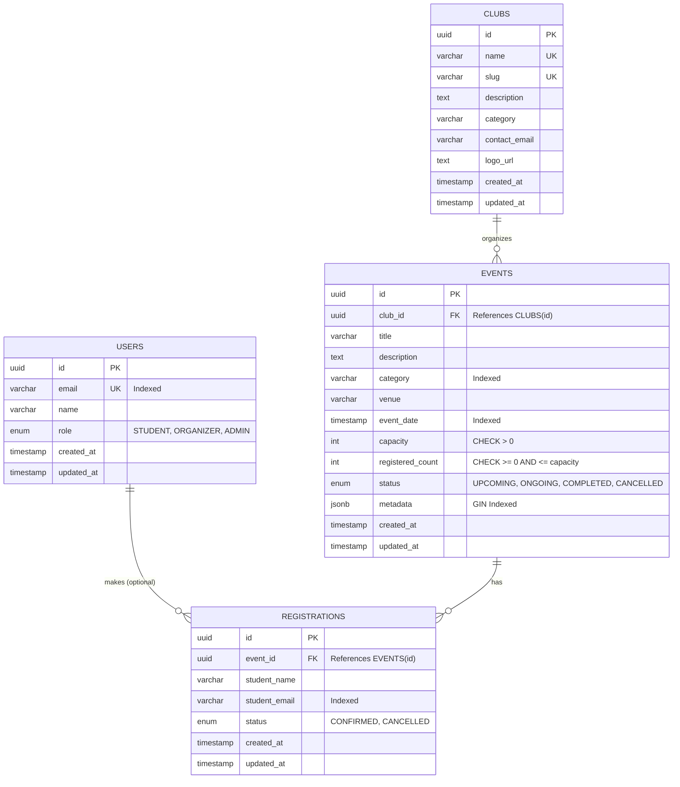

# CampusConnect Database Entity-Relationship (ER) Architecture

## 1. Entity-Relationship Diagram

## 2. Relational Schema Normalization Analysis

The schema satisfies Third Normal Form (3NF) and Boyce-Codd Normal Form (BCNF):

### First Normal Form (1NF)
- **Atomic Attributes**: All columns store atomic, non-decomposable values (e.g., separate fields for `student_name`, `student_email`, `venue`).
- **Primary Keys**: Every relation has a defined Primary Key (`UUID`), ensuring unique row addressability.
- **No Repeating Groups**: Repeating collections (e.g., student registrations) are normalized into their own relation (`registrations`) rather than multi-valued arrays inside `events`.

### Second Normal Form (2NF)
- **Full Functional Dependency**: The relation is in 1NF, and every non-key attribute is fully functionally dependent on the entire primary key.
- Because single-attribute surrogate keys (`id UUID`) are utilized as primary keys for all tables, no partial dependency on a composite key can exist.

### Third Normal Form (3NF)
- **Elimination of Transitive Dependencies**: Non-key attributes depend only on the primary key, with no transitive dependencies ($X \to Y$ and $Y \to Z$).
- For example, `club_name` and `contact_email` are stored strictly in `CLUBS`. The `EVENTS` table stores only the foreign key `club_id`. Event queries obtain club details via relational joins, preventing update anomalies.

### Boyce-Codd Normal Form (BCNF)
- For every non-trivial functional dependency $X \to Y$, $X$ is a superkey.
- In `REGISTRATIONS`, the composite constraint `(event_id, student_email)` uniquely identifies a single registration record, maintaining candidate key integrity.

## 3. Concurrency Invariant & Constraint Architecture
- **Duplicate Prevention**: Unique composite constraint `(event_id, student_email)` enforces that no email address can register more than once per event.
- **Capacity Integrity**: Check constraint `chk_events_registered_bounds` ensures `registered_count <= capacity` at the storage layer.
- **Cascading Integrity**: `ON DELETE CASCADE` on foreign keys cleans up orphaned event registrations and club events automatically.
